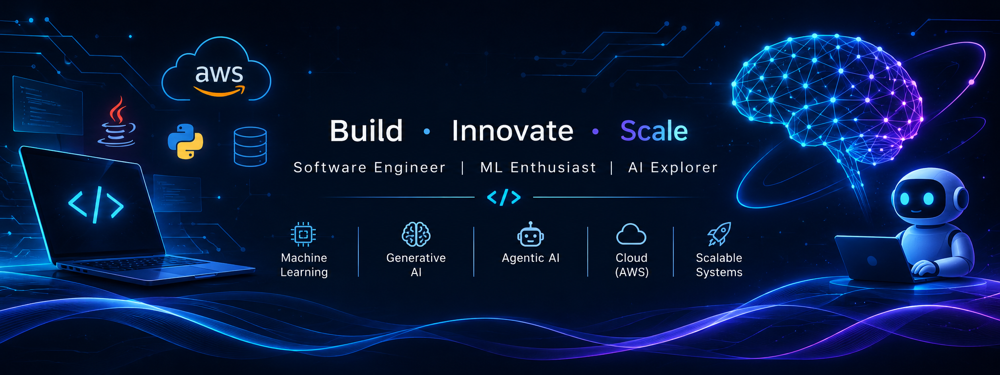

## 💻 Technical Skills

### 👨‍💻 Programming Languages

### ⚙️ Backend Development

### ☁️ Cloud Computing & AWS

### 🗄️ Databases

### 🎨 Frontend Development

### 🤖 Machine Learning

### ✨ Generative AI

### 🧠 Agentic AI

### 🛠️ Developer Tools & Technologies

### 📚 Computer Science Fundamentals

- Data Structures & Algorithms
- Object-Oriented Programming (OOP)
- Database Management Systems (DBMS)
- Operating Systems
- Computer Networks
- System Design
- Distributed Systems
